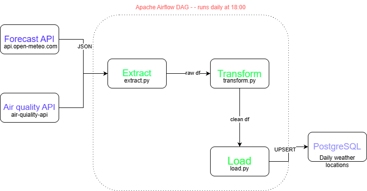
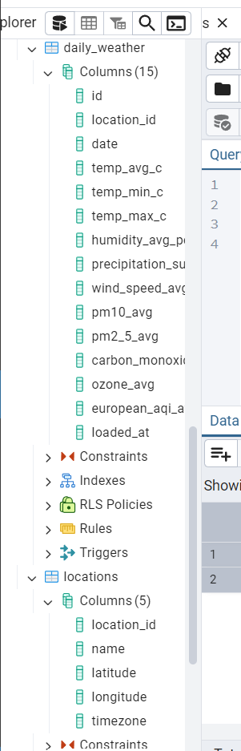

# NYC & Tbilisi Weather + Air Quality ETL Pipeline

An end-to-end ETL pipeline that extracts hourly weather and air quality data
from the Open-Meteo API, transforms it into daily metrics with pandas, and
loads the result into PostgreSQL.

## What Problem This Solves

Weather and air quality APIs return nested hourly JSON. That format is useful
for APIs, but not ideal for analytics. This project turns raw hourly responses
into a clean relational table that can be queried, reloaded safely, and
scheduled as a daily data pipeline.

## Architecture



| Layer | Tool |
|---|---|
| Extract | Python `requests` + Open-Meteo API |
| Transform | `pandas` daily aggregation |
| Load | `psycopg2` UPSERT into PostgreSQL |
| Database | PostgreSQL in Docker |
| Scheduling | Airflow DAG included in `dags/weather_dag.py` |
| Testing | `pytest` transform tests |

## Cities Tracked

| City | Latitude | Longitude | Timezone |
|---|---:|---:|---|
| Tbilisi, Georgia | 41.7151 | 44.8271 | Asia/Tbilisi |
| New York, USA | 40.7128 | -74.0060 | America/New_York |

## Project Structure

```text
weather-etl-pipeline/
├── dags/
│   └── weather_dag.py
├── data/
│   └── sample_output.csv
├── docs/
│   └── weatherapp.drawio.png
├── sql/
│   └── schema.sql
├── src/
│   ├── extract.py
│   ├── transform.py
│   ├── load.py
│   └── pipeline.py
├── tests/
│   └── test_transform.py
├── docker-compose.yml
├── requirements.txt
└── README.md
```

## How To Run

### 1. Create and activate a virtual environment

```powershell
python -m venv .venv
.\.venv\Scripts\activate
pip install -r requirements.txt
```

### 2. Start PostgreSQL

```powershell
docker compose up -d postgres
```

PostgreSQL connection details:

```text
Host: 127.0.0.1
Port: 55432
Database: weather_etl
Username: weather_user
Password: weather_password
```

### 3. Run the ETL pipeline

```powershell
.\.venv\Scripts\python.exe src\pipeline.py
```

### 4. Query the loaded data

```powershell
docker exec weather_etl_postgres psql -U weather_user -d weather_etl -c "SELECT l.name, d.date, d.temp_avg_c, d.pm2_5_avg, d.european_aqi_avg FROM daily_weather d JOIN locations l ON d.location_id = l.location_id ORDER BY d.date DESC, l.name;"
```

## Sample Output

| city | date | temp_avg_c | pm2_5_avg | european_aqi_avg |
|---|---|---:|---:|---:|
| New York | 2026-07-14 | 27.80 | 17.36 | 51.1 |
| Tbilisi | 2026-07-14 | 26.81 | 10.44 | 26.5 |

The full sample row format is available in `data/sample_output.csv`.

## Tests

```powershell
.\.venv\Scripts\python.exe -m pytest
```

The tests validate that hourly weather and air quality data is aggregated into
one complete daily row, and that incomplete days are rejected.

## Airflow

`dags/weather_dag.py` defines a daily DAG called `weather_etl_daily` that calls
`run_pipeline()`.

Docker Compose starts the existing data PostgreSQL service on host port 55432,
a separate PostgreSQL metadata service, an Airflow webserver, and a LocalExecutor
scheduler. The custom image uses official `apache/airflow:2.11.2-python3.11` and
installs `requirements.txt` while keeping Airflow pinned. The requests and
psycopg2-binary pins match the image dependencies; the image build runs `pip check`. This is the latest
published 2.x release; [Airflow 2.x is end-of-life](https://github.com/apache/airflow#version-life-cycle).
This setup is for local development.

From PowerShell in the repository root (Docker Desktop must be running):

```powershell
Copy-Item .env.example .env # First setup only; edit the placeholder credentials.
docker compose up -d --build
docker compose ps -a
```

Initialization migrates the metadata database and creates the UI user automatically.
Wait for the webserver and scheduler to become healthy. Open http://localhost:8080
and log in with `AIRFLOW_ADMIN_USER` / `AIRFLOW_ADMIN_PASSWORD` from `.env`
(example placeholders: `airflow` / `change-me-local-only`). The metadata password
must be URL-safe because it is used in a database URI. User creation only applies
to the initial setup; editing `.env` does not reset an existing UI password.

Trigger and inspect the DAG from the UI, or run:

```powershell
docker compose exec airflow-scheduler airflow dags list-import-errors
docker compose exec airflow-scheduler airflow dags unpause weather_etl_daily
docker compose exec airflow-scheduler airflow dags trigger weather_etl_daily
docker compose exec airflow-scheduler airflow dags list-runs -d weather_etl_daily
# Copy a run ID from the output to inspect its tasks:
docker compose exec airflow-scheduler airflow tasks states-for-dag-run weather_etl_daily '<run-id>'
```

Save your screenshot of a successful DAG run as `docs/airflow_dag_run.png`.
Task logs persist in the `airflow_logs` Docker volume and are available in the UI.
A named volume avoids Windows bind-mount write-permission failures. `dags`, `src`, and `sql` are
mounted into Airflow; `PYTHONPATH` makes pipeline modules importable.
Inside Docker the ETL uses `postgres:5432`; local Python keeps the defaults
`127.0.0.1:55432`. Override `POSTGRES_HOST`, `POSTGRES_PORT`, `POSTGRES_DB`,
`POSTGRES_USER`, and `POSTGRES_PASSWORD` as process environment variables for
local runs. Compose reads `.env` for its own placeholder settings; local Python
does not automatically load that file.

Stop the stack while preserving both databases:

```powershell
docker compose down
```

Rebuild with `docker compose up -d --build` after changing requirements.

Verified on 2026-10-28: `manual_verification_20261028` and its
`run_weather_etl` task succeeded, data rows were present, all four long-running
services were healthy, no DAG import errors were reported, and UI login returned
HTTP 200 at `/home`. Initial dependency conflicts were fixed by updating the two
pins above; a Windows log bind-mount permission error was fixed with the named
volume. The image still emits RequestsDependencyWarning about bundled chardet 6
and Airflow 3 migration deprecation warnings; these did not prevent the verified run.

## Project Stats

Measured against the running Compose data database on **2026-10-28** (Asia/Tbilisi),
after the successful Airflow verification run:

| Metric | Measured value |
|---|---|
| Total rows in `daily_weather` | 2 |
| New York rows | 1 |
| Tbilisi rows | 1 |
| Earliest date loaded | 2026-10-27 |
| Latest date loaded | 2026-10-27 |
| Distinct dates loaded | 1 |
| Locations (`locations` table; both have data) | 2 |
| Tests passed (`python -m pytest`, local virtual environment) | 2 |

Reproduce the database measurements from PowerShell:

```powershell
Get-Content -Raw sql/project_stats.sql | docker compose exec -T postgres psql -U weather_user -d weather_etl -v ON_ERROR_STOP=1
.\.venv\Scripts\python.exe -m pytest
```

History is shallow: only one day is loaded. Extraction supports a configurable
`past_days` lookback through `run_pipeline(past_days=...)`, but has no explicit
start/end date parameters, and `transform_daily()` currently returns only the
earliest complete day in the response. Increasing the lookback alone will not
backfill every day. A suggested follow-up is to choose a supported API lookback,
transform every complete historical day, and UPSERT each city/day; for older
history, add explicit historical date-range extraction using appropriate API
endpoints. This backfill has **not** been implemented or run.

## Key Engineering Decisions

**Idempotent loads**: `daily_weather` has a unique constraint on
`(location_id, date)`, and `load.py` uses UPSERT logic. Re-running the pipeline
updates an existing row instead of creating duplicates.

**Separation of concerns**: extraction, transformation, loading, orchestration,
schema, and tests live in separate files.

**Complete-day logic**: the transform step only accepts full 24-hour days, which
prevents partial current-day API data from entering the daily table.

## Data Source

Weather and air quality data is provided by
[Open-Meteo](https://open-meteo.com/), which does not require an API key for
this use case.
